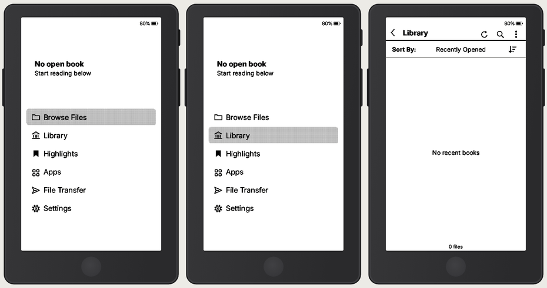
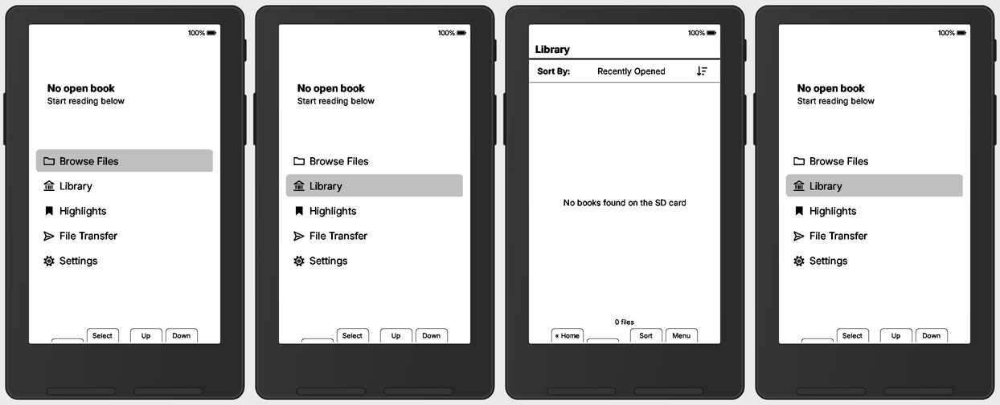
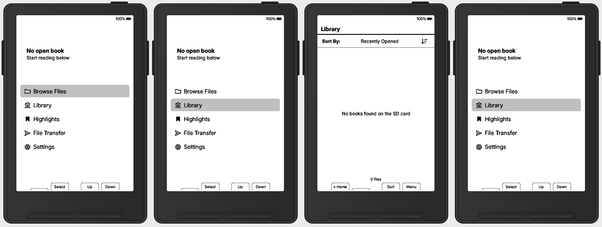
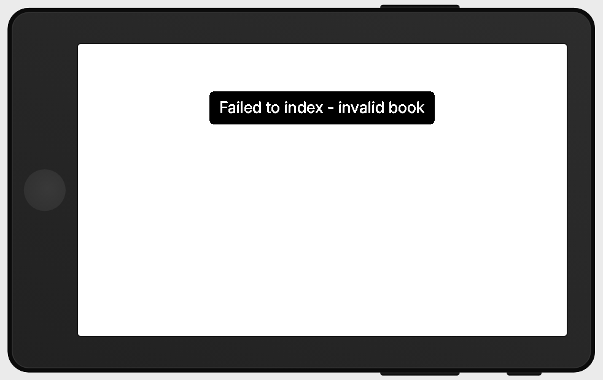
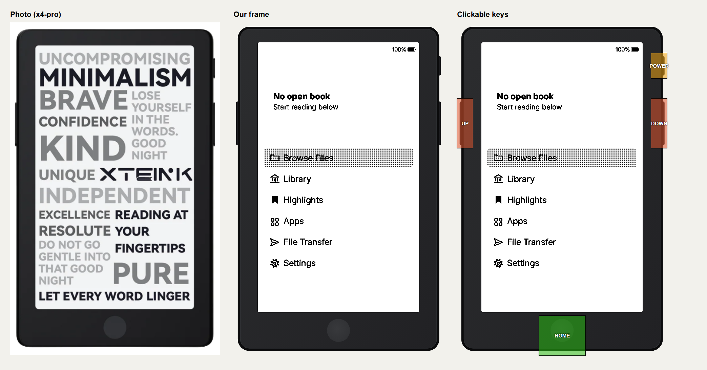
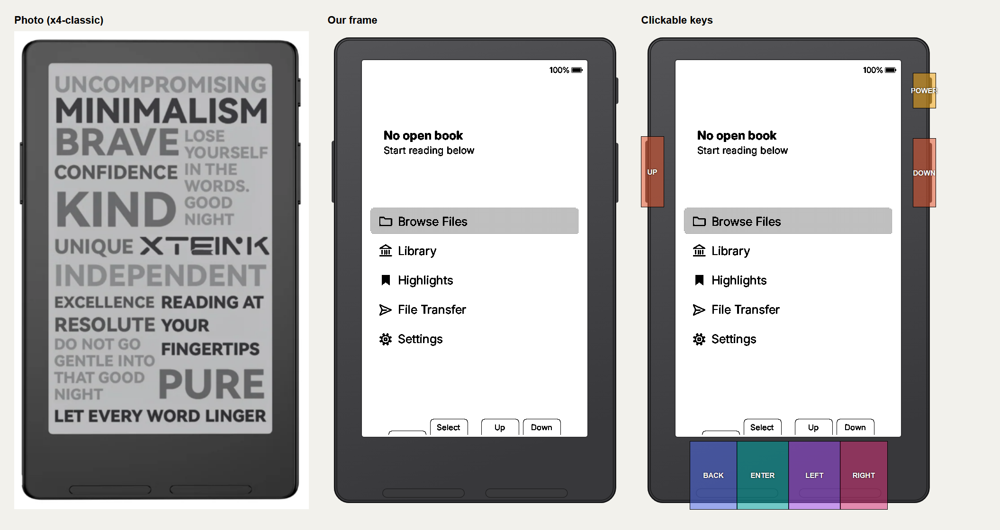
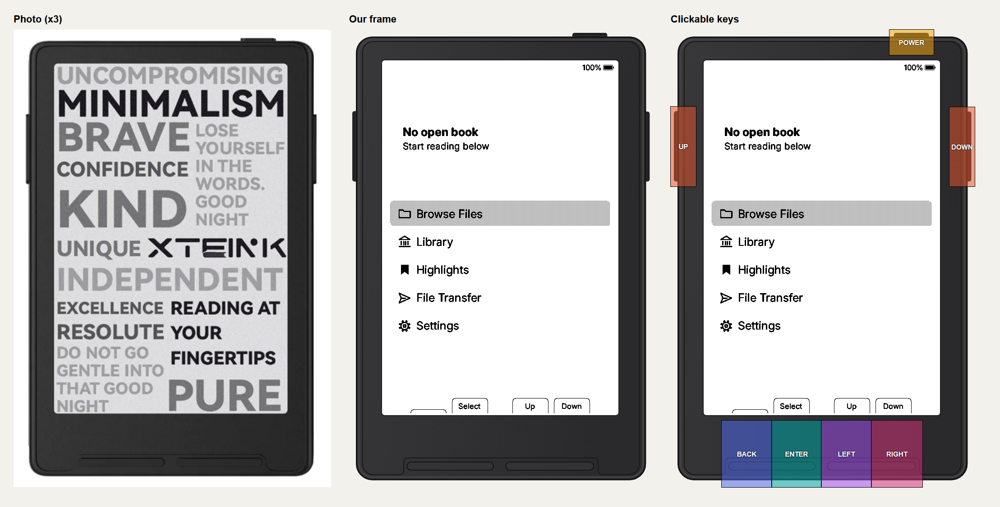

# Reader Simulator

Try e-reader firmwares for the Xteink X3, X4 Classic and X4 Pro without the reader:

- **In your browser, nothing to install:** https://pewpewzxc.github.io/reader-simulator/ (Chrome, Edge, Firefox or Safari, on a computer, tablet or phone)
- **On Windows:** the Reader Simulator app (see *How to use it* below)

This is an unofficial community tool, not made by or affiliated with Xteink.

The simulator shows a drawing of the reader with the firmware running on its screen.
Click the reader's keys to press them. On the X4 Pro, click the screen to touch it (on a phone or tablet, use your
finger). Every new simulated SD card comes with two free books and an English dictionary, so you can try reading and
looking up words straight away. In the browser, each firmware offers its newest versions (3 by default).

| X4 Pro | X4 Classic | X3 |
| --- | --- | --- |
|  |  |  |

The reader turns when the firmware turns the page sideways:



## How to use it
1. Download `ReaderSimulator-Setup.exe` from the [Releases](../../releases) page and run it.
   No administrator rights are needed.
2. Windows may say "Windows protected your PC": the program is not signed (a certificate costs money every year).
   Click **More info**, then **Run anyway**.
3. Open **Reader Simulator**, pick a device and a firmware, and click **Start**.
   The firmware downloads the first time (about 7 MB).
4. To read your own books, click **Add books** (EPUB, TXT and the other files the firmware reads).

Each firmware has its own simulated SD card. **Fresh SD card** empties it.

## Which firmwares
The list comes from [`sim-windows/firmwares.json`](sim-windows/firmwares.json). A firmware is offered when its own source code
builds and starts in the simulator. The builds are made by GitHub Actions in this repo
([`build-firmwares.yml`](.github/workflows/build-firmwares.yml)) straight from each firmware's
GitHub release, and every download is checked against its SHA-256 before it runs.

Firmwares on the older simulator library (YACP and other CrossPoint forks) show the same reader drawing.

The factory firmware from Xteink cannot run here: it is closed source, and this simulator builds firmwares from source.

## The device drawings
`device-frames/frames/` has our own drawings of the three readers (SVG + PNG) and the key areas (`.keys`).
They were drawn from the official sizes, not copied from photos.

| X4 Pro | X4 Classic | X3 |
| --- | --- | --- |
|  |  |  |

## Build a firmware yourself
You need Git for Windows, Python 3.12, PlatformIO (`pip install platformio`), the WinLibs (or MSYS2 UCRT64) g++,
ffmpeg, and the SDL2 MinGW package `SDL2-devel-2.32.10-mingw.tar.gz` unpacked into `sim-windows/deps/`.
```bash
cd sim-windows
python -I tools/latest_refs.py | bash tools/try_all.sh      # build + test every firmware in the list
bash tools/make_release.sh                                   # zips + index.json
```
`sim-windows/README.md` lists every Windows fix. The firmwares' own code is never changed.

## Licence
MIT, see [LICENSE](LICENSE). Firmwares, simulator libraries and SDL2 keep their own licences: see [CREDITS.md](CREDITS.md).
Xteink, X3, X4 and X4 Pro are named only to say which reader is simulated. This project is not made by Xteink.

## Building it yourself
| Folder | What | How |
| --- | --- | --- |
| `sim-windows/` | builds a firmware's simulator on Windows (Git Bash, PlatformIO, WinLibs g++, SDL2) | see `sim-windows/README.md` |
| `app/` | the Windows app (WPF, .NET Framework 4.8: runs on any Windows 10/11) | `app/build.ps1` (per-user .NET SDK in `tools/dotnet`) |
| `installer/` | the setup program (Inno Setup 6, per-user, no admin) | compile `installer/ReaderSimulator.iss`; `installer/test-clean.ps1` tests install, app self-test and uninstall |
| `web/` | the browser version (Emscripten / WebAssembly) | `web/build.py`; serve `web/build/out/` with `web/serve.py` |
| `device-frames/` | the reader drawings and key areas | `device-frames/tools/gen.py` |

The app downloads builds only over HTTPS from this repo's releases and checks each one's SHA-256 before it
unpacks or runs anything. It sends nothing anywhere.
