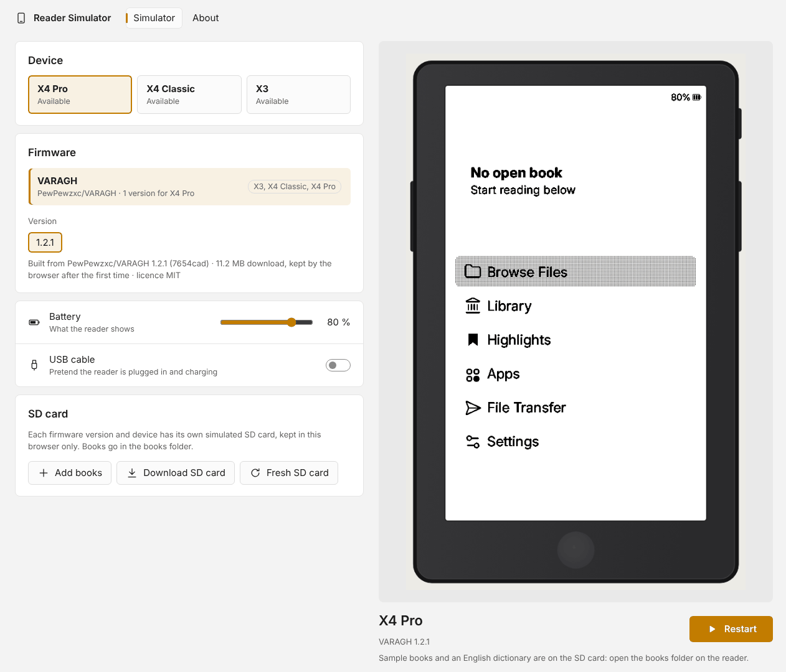

<div align="center">

# Reader Simulator

**Run community firmwares for the Xteink X4 Pro, X4 Classic and X3 e-readers in your browser — no device needed.**

[](https://github.com/PewPewzxc/reader-simulator/actions/workflows/pages.yml)
[](https://github.com/PewPewzxc/reader-simulator/actions/workflows/build-firmwares.yml)
[](https://github.com/PewPewzxc/reader-simulator/releases/latest)
[](LICENSE)

[**Launch the simulator**](https://pewpewzxc.github.io/reader-simulator/) · [Windows app](#windows-app) · [Supported firmwares](#supported-firmwares) · [Privacy](#privacy) · [Legal](#legal)



</div>

## Overview

Reader Simulator builds open-source e-reader firmwares from their own source code for WebAssembly and Windows,
and runs them inside an accurate drawing of the reader. You can try a firmware before you flash it, compare
versions side by side, or develop and demo a firmware without a device on your desk.

- **Runs in any modern browser** — Chrome, Edge, Firefox and Safari, on a computer, tablet or phone. Nothing to install.
- **Several versions of every firmware** — the newest releases of each one, so you can compare them before updating.
- **Always current** — GitHub Actions checks every firmware for new releases each week, builds them, tests them in a
  headless browser and publishes the ones that pass. No manual step.
- **The real controls** — click or tap the reader's keys, use the X4 Pro's touchscreen (tap, hold, swipe), or use
  the keyboard. A built-in guide lists every key and gesture.
- **Ready to read** — every new simulated SD card comes with two public-domain books and an English dictionary.
  Add your own EPUB and TXT files at any time.
- **Faithful hardware** — the screen turns with the firmware's orientation, and the device drawings are made from
  the readers' official dimensions.

## Getting started

### In the browser (recommended)

1. Open the simulator from the link at the top of this page.
2. Pick a device, a firmware and a version, then press **Start**. The firmware (about 10 MB) is downloaded once
   and cached by your browser.
3. Use the reader as you would the real one. The **Controls** card below it explains every key and gesture.

| X4 Pro (touch) | X4 Classic | X3 |
| :---: | :---: | :---: |
|  |  |  |

### Windows app

The same simulator as a desktop program, for working offline or with books from a folder on your PC. Most people
do not need it.

1. Download `ReaderSimulator-Setup.exe` from the [latest release](https://github.com/PewPewzxc/reader-simulator/releases/latest)
   and run it. No administrator rights are needed; it installs for the current user only.
2. Choose a device and a firmware and click **Start**. Each firmware is downloaded the first time it is used
   (about 7 MB) and checked against its SHA-256 checksum.

> [!NOTE]
> The installer is not code-signed yet, so Windows SmartScreen may warn about it. If you prefer not to run unsigned
> software, use the browser version, which offers the same firmwares. A Microsoft Store release is under
> consideration ([roadmap](ROADMAP.md)).

## Supported firmwares

Firmwares are listed in [`sim-windows/firmwares.json`](sim-windows/firmwares.json). A version is offered only after
its source code has built and started successfully in the simulator; the simulator itself always shows the current
list.

| Firmware | Based on |
| --- | --- |
| [VARAGH](https://github.com/PewPewzxc/VARAGH) | CrossInk |
| [CrossPoint Reader](https://github.com/crosspoint-reader/crosspoint-reader) | — |
| [CrossInk](https://github.com/uxjulia/crossink) | CrossPoint |
| [Witchhunt Reader](https://github.com/jpirnay/witchhunt-reader), [InkPointX](https://github.com/yokki-vans/InkPointX), [YACP](https://github.com/Sichroteph/YACP), [CrossNotes](https://github.com/HilbergK/CrossNotes), [CrossDiTo](https://github.com/dito94/CrossDiTo), [PocketDeck OS](https://github.com/ashokslsk/PocketDeck-OS), [duet](https://github.com/lauren-alexandra/duet-xteink), [Xteink Pokemon game](https://github.com/padge01/xteink-pokemon-game) and others | CrossPoint |

**Requirements for a firmware:** public source code on GitHub, a PlatformIO project, and a CrossPoint, CrossInk or
FreeInk base. The simulator adds its own setup to firmwares that do not ship one, without changing their code.

**Not supported:** closed-source firmwares, including Xteink's factory firmware, cannot be built from source. See
the [roadmap](ROADMAP.md) for what running them would take.

## How it works

```
firmware release on GitHub ──► GitHub Actions ──► simulator build ──► test ──► GitHub Pages / Releases
     (source code)             (weekly or on      (PlatformIO +        (headless      (browser and
                                demand)            simulator library,   browser /      Windows app)
                                                   Emscripten or g++)   smoke test)
```

Each firmware is compiled against a desktop simulator library
([crossink-simulator](https://github.com/uxjulia/crossink-simulator) or
[crosspoint-simulator](https://github.com/crosspoint-reader/crosspoint-simulator)) that stands in for the reader's
hardware: display, keys, touchscreen, SD card, battery and clock. The library version is chosen from the firmware's
release date, and small compatibility fixes are applied to the library at build time
([`patch_libdeps.py`](sim-windows/patch_libdeps.py)). The firmware's own source is never modified.

Technical details: [`web/README.md`](web/README.md) (browser build and publishing) and
[`sim-windows/README.md`](sim-windows/README.md) (Windows build).

## Privacy

Reader Simulator has no accounts, no analytics, no cookies, no advertising and no tracking.

- **Your books stay on your device.** Files you add are stored in your browser's local storage (IndexedDB) or, in
  the Windows app, in your user folder. They are never uploaded.
- **Network requests** go only to GitHub: the page is served by GitHub Pages and firmware builds are downloaded from
  this repository's GitHub Releases. GitHub may log those requests as described in the
  [GitHub Privacy Statement](https://docs.github.com/en/site-policy/privacy-policies/github-general-privacy-statement).
- **Preferences** of the page (such as your last choices) are kept in your browser's local storage.
- The Windows app sends no data anywhere; it only downloads the firmware list and builds over HTTPS.

## Security

- Every firmware is built by GitHub Actions in this public repository, from the tagged source of its own release;
  the exact source commit is recorded in each build's `build.json`.
- The Windows app downloads builds only over HTTPS from this repository and verifies each file's SHA-256 checksum
  before unpacking or running it.
- In the browser, firmwares run inside the browser's WebAssembly sandbox with no access to your files beyond the
  simulated SD card.

To report a vulnerability, please contact the maintainer privately (see [Author](#author)) rather than opening a
public issue.

## Development

| Folder | Contents |
| --- | --- |
| [`web/`](web/) | Browser build (Emscripten / WebAssembly), the web page and its publishing scripts |
| [`sim-windows/`](sim-windows/) | Windows build of a firmware's simulator, the firmware list and the compatibility fixes |
| [`app/`](app/) | Windows app (WPF, .NET Framework 4.8, Windows 10 and 11) |
| [`installer/`](installer/) | Per-user Inno Setup installer and a clean-machine test script |
| [`device-frames/`](device-frames/) | Device drawings (SVG and PNG) and key areas |
| [`samples/`](samples/) | Books and dictionary placed on every new simulated SD card |
| [`.github/workflows/`](.github/workflows/) | Builds, tests and releases |

The device drawings are original artwork made from the readers' official dimensions:

| X4 Pro | X4 Classic | X3 |
| :---: | :---: | :---: |
|  |  |  |

## Contributing

Contributions are welcome:

- **Add a firmware:** open an issue with a link to its GitHub repository, or a pull request adding it to
  [`sim-windows/firmwares.json`](sim-windows/firmwares.json). The next build run tries it.
- **Report a problem:** open an issue with the device, firmware and version shown in the simulator.
- **Firmware bugs** belong in that firmware's own repository; the simulator runs its code unchanged.

Planned and possible work is listed in [ROADMAP.md](ROADMAP.md).

## Legal

**No affiliation.** Reader Simulator is an independent community project. It is not made, endorsed or supported by
Xteink or by the authors of the firmwares it runs. Xteink, X3, X4 and X4 Pro are trademarks of their respective
owners and are used only to identify the simulated devices.

**Licences.** This project's own code and device drawings are released under the [MIT License](LICENSE).
Every firmware keeps its own licence, which ships with each build as `LICENSE-firmware.txt`. The simulator libraries,
SDL2, the GCC runtime and other parts keep theirs; see [CREDITS.md](CREDITS.md).

**Sample content.** The sample books are from [Standard Ebooks](https://standardebooks.org) and are dedicated to the
public domain (CC0 1.0). The dictionary is built from [WordNet 3.0](https://wordnet.princeton.edu)
© Princeton University, used under the WordNet License (included on the card as `dictionaries/wordnet/LICENSE.txt`).

**No proprietary firmware.** No closed-source or factory firmware is included in, built by or distributed through
this project.

**Disclaimer.** The software is provided "as is", without warranty of any kind. A simulator is an approximation:
behaviour on a real device may differ. Flash firmware to your reader at your own risk.

## Author

Created and maintained by **PewPewzxc** — [GitHub](https://github.com/PewPewzxc) ·
[LinkedIn](https://www.linkedin.com/in/alireza-pakseresht-koubijari/).

Thanks to the authors of every firmware and simulator library listed in [CREDITS.md](CREDITS.md).
